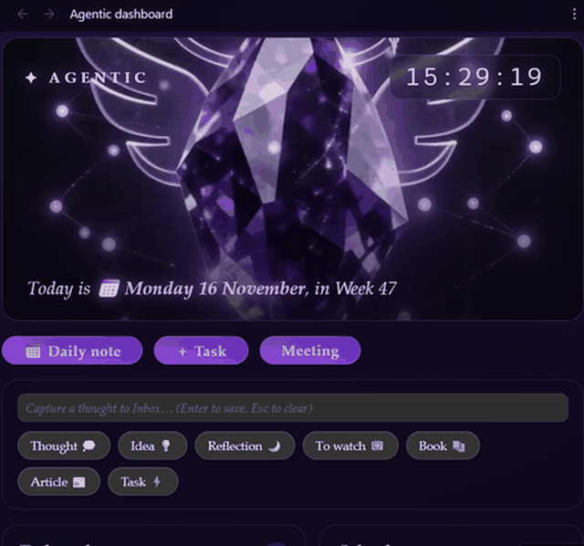

# Agentic Dashboard

A crystal-glass daily dashboard for [Obsidian](https://obsidian.md): a video hero with a live clock, quick capture to your Inbox, today's tasks, a monthly calendar, vault stats, meetings, recent notes and your Inbox — all in one custom view.

**No Dataview, no Templater, no other plugins required.** Works on desktop and mobile. Agent-agnostic: point its folder settings at any vault layout — it doesn't care which agent or workflow feeds your notes.



## Features

- ✦ **Hero banner** — animated video (or poster image) with your live clock and today's date / ISO week, plus an optional live weather chip (city you choose, refreshed with the dashboard)
- 🌤️ **Weather** — optional chip beside the clock: pick any city, temperature in °C or °F, updated on the plugin's auto-refresh (Open-Meteo, no API key, off by default); shows a cached/offline indicator if the network is unavailable
- ＋ **Quick capture** — one-Enter captures for thoughts, ideas and articles; chips are standalone: tap one and it stays selected (also across saves), tap another to switch — no silent reset; the reflection, to-watch and book chips open a fuller form (context + takeaway, link, author + reading status) and build a structured inbox note with frontmatter (`author`, `status`, `source`) and body sections
- ＋ **Two ways to add tasks** — the `Task ⚡` chip is quick capture: type one line, hit Enter, it lands in today's daily note; the **＋ Task** button opens the proper form (name, date, priority, repeat) for scheduling ahead
- **Tasks today** — open tasks from today's daily note plus every task across the vault that is due today or overdue (📅 / ⏳ / 🛫 emoji dates), click to toggle done
- **Task features from the Tasks ecosystem** — the ＋ Task button opens a rich form (name, date, priority, repeat) so tasks for future days can be scheduled today; completing a task stamps it with a done date ✅; adding one stamps a created date ➕; recurring tasks (🔁 every week, every 3 days, every weekday, `when done`, …) generate their next occurrence automatically on completion; priorities (⏫ 🔼 🔽) are preserved and sort overdue lists; cancelled tasks (`- [-]`) are excluded; `*` and numbered checkboxes are supported
- **Calendar** — Monday-start month view, dots on days with a daily note, click any day to open/create that daily note
- **Meetings today** — notes in the meetings folder whose frontmatter `date` is today; the **Meeting** button opens a full form (name, date, time, agenda, notes, decisions, action items) that builds the complete meeting note
- **At a glance reveals** — every stat tile is clickable: open and completed tasks, inbox notes, today's meetings and recently modified files each open a clickable list; the notes stat opens the file explorer
- **Recent notes** — 7 most recently modified notes
- **Inbox** — 10 newest captures with their type tag
- **Auto-refresh** — the dashboard updates when your vault changes
- **Linked notes (optional)** — with *Link notes together* on, the daily note gains a `## Meetings` and a `## Captures` section linking to that day's notes, and meeting notes link back to their day — so the graph and backlinks come alive; off by default
- **Open at startup** — automatically opens when Obsidian starts (toggle in settings)
- **Agent & automation actions** — official Obsidian CLI commands (`obsidian agentic-dashboard:add-task text="..."`) plus `obsidian://agentic-dashboard` URI actions; agents and scripts can drive the vault with no extra plugin or server

## Install

1. Open **Settings → Community plugins** and make sure Restricted mode is off
2. **Browse**, search for **Agentic Dashboard**, install and enable
3. Click the ✦ sparkles ribbon icon or run **"Open Agentic Dashboard"** from the command palette

### Manual install

Download `manifest.json`, `main.js` and `styles.css` from the latest release into
`<vault>/.obsidian/plugins/agentic-dashboard/`, then enable the plugin in settings.

## Configuration (Settings → Agentic Dashboard)

| Setting | Default | What it does |
| --- | --- | --- |
| Open dashboard at startup | on | Auto-opens the dashboard when Obsidian starts |
| --- | --- | --- |
| Journal folder | `Journal` | Where `YYYY-MM-DD.md` daily notes live |
| Inbox folder | `Inbox` | Where quick captures are stored |
| Meetings folder | `Meetings` | Where new meetings are created |
| Dashboard note | *(empty)* | Name of your dashboard note — new daily notes link to it (empty = no link) |
| Hero video path | *(empty)* | Video behind the hero (empty → gradient) |
| Poster (desktop / mobile) | *(empty)* | Fallback image when there is no video |
| Link notes together | off | Connect daily notes, meetings and captures with links (respects your Files and links format preference) |
| Max tasks shown | `18` | Cap for the Tasks today card |
| Auto refresh | `60` s | Background refresh interval for the dashboard and weather (0 = off) |
| Show weather | off | Live weather chip beside the clock (Open-Meteo, no API key) |
| Weather city | *(empty)* | City name to fetch weather for |
| Weather units | `Celsius` | Celsius (°C) or Fahrenheit (°F) |

Point the three folder settings at any folders in your vault and the dashboard adapts to your layout. Daily notes, meetings and captures are created with sensible frontmatter (`type`, `date`, `time`, `tag`) so they stay Dataview-friendly.

### Dashboard note template

Daily notes can link back to a central dashboard note (like the `Agentic Dashboard` note in a journaling setup). Copy [`Dashboard.md`](Dashboard.md) from this repo anywhere into your vault, set **Dashboard note** in the plugin settings to that note's name, and every daily note the plugin creates will carry a link to it. Leave the setting empty and daily notes have no link at all.

### Hero video (optional)

The hero banner shows a calm gradient out of the box — no extra files needed. To enable the animated crystal video hero:

1. Download `hermes_obsidian_animated_profile_with_long_crystal_tone.mp4` (~1 MB) from the [latest release](https://github.com/faizulahasun-cloud/agentic-dashboard/blob/main/assets/hermes_obsidian_animated_profile_with_long_crystal_tone.mp4) - one copy in the repo, no longer shipped as a release asset
2. Put it anywhere in your vault (e.g. an `assets/` folder)
3. Set **Hero video path** in the plugin settings to that vault-relative path (e.g. `assets/hermes_obsidian_animated_profile_with_long_crystal_tone.mp4`)

Optional poster images (shown instead of the video when a device can't play it) work the same way: add them to the vault and point **Poster (desktop)** / **Poster (mobile)** at them. Skip all of this and you simply get the gradient.

## Agent & automation actions

Any agent, script or shortcut can drive the vault — no extra plugin or server needed. Two native channels are built in:

### Obsidian CLI (desktop, Obsidian 1.12.7+)

Requires the Obsidian CLI to be enabled (**Settings → General → Command line interface**). Commands return text output, so agents get feedback directly:

| Command | What it does |
|---|---|
| `obsidian agentic-dashboard` | Opens the dashboard |
| `obsidian agentic-dashboard:add-task text="Call plumber"` | Adds `- [ ] Call plumber ➕ … 📅 …` to today's daily note (created date and due-date stamps included, note created if missing) |
| `obsidian agentic-dashboard:add-task text="Call plumber" date=2026-11-14` | Adds to that day's daily note (future days created if missing) |
| `obsidian agentic-dashboard:add-task text="Call plumber" date=2026-11-20 priority=high recurrence="every month"` | Task with priority and repeat rule |
| `obsidian agentic-dashboard:capture text="Read X" type=idea` | Creates an Inbox note (type: thought/idea/reflection/to-watch/book/article) |
| `obsidian agentic-dashboard:meeting title="Design review" date=2026-11-20 time=14:30` | Creates a meeting note (date/time/agenda/notes/decisions/actions all optional) |
| `obsidian agentic-dashboard:new-daily date=2026-11-14` | Creates (if missing) and opens that daily note |
| `obsidian agentic-dashboard:open-note path="folder/note.md"` | Opens that exact vault path |
| `obsidian agentic-dashboard:find-note query=dashboard` | Best-match search over note names, opens the winner |

Add `vault="<name>"` before the command to target a specific vault. Example:

```powershell
obsidian vault="Ai diary" agentic-dashboard:add-task text="Water the plants"
```

### obsidian:// URI (desktop & mobile)

The plugin registers `obsidian://agentic-dashboard?action=...` — useful for links inside notes, iOS Shortcuts, and environments without a terminal:

| Action | URL | What it does |
|---|---|---|
| Add task | `...?action=add-task&text=Call plumber` | Appends to today's daily note |
| Add task on a date | `...?action=add-task&text=Call plumber&date=2026-11-14&priority=high&recurrence=every week` | Task with date, priority and repeat |
| Capture to inbox | `...?action=capture&text=Read X&type=idea` | Creates an Inbox note |
| New meeting | `...?action=meeting&title=Design review&date=2026-11-20&time=14:30` | Creates a meeting note |
| Daily note | `...?action=new-daily` (`&date=` optional) | Creates if missing and opens it |
| Open a note | `...?action=open-note&path=Journal/2026-11-13.md` | Opens that exact vault path |
| Find a note | `...?action=find-note&query=dashboard` | Best-match search, opens the winner |
| Open dashboard | `...?action=open-dashboard` | Focuses the dashboard |

Base: `obsidian://agentic-dashboard?action=<action>&...`. Spaces in parameters should be URL-encoded (`%20`). URI actions confirm with an in-app notice.

Agents can also just write notes directly (plain file edits) — the dashboard listens to vault events and refreshes itself.

## Compatibility

Requires Obsidian **1.4.0+**. Works on desktop and mobile. Themes (like [Hermes Crystal](https://github.com/faizulahasun-cloud/hermes-crystal)) style it automatically; without a theme it uses its own built-in crystal-glass dark look.

## Companion theme: Hermes Crystal

The theme this dashboard was designed around is also a community theme: [Hermes Crystal](https://github.com/faizulahasun-cloud/hermes-crystal) — amethyst crystal-glass styling with a nebula background, matching the dashboard's look. It's optional: the dashboard ships with its own built-in crystal-glass dark look and works with any theme.

## License

[MIT](LICENSE) © 2026 MD Fizul Ahasun
